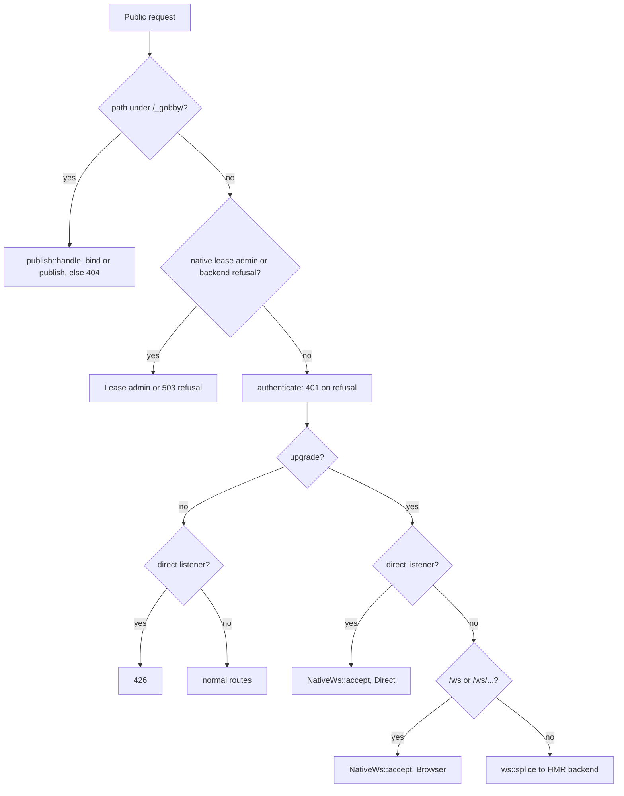

# Native WebSocket transport

This contract covers how gdaemon serves the browser and direct WebSocket entries
natively, how a public connection reaches the Python application handlers through
a private leg, and how the Python publisher binds and fans out frames. It is the
reference for B3 of `.gobby/plans/native-ws-transport.md` (#24622).

Code is the source of truth. Where this document names a symbol, the file and
symbol are given so a reader can confirm it.

## Entry modes and path claims

gdaemon's front door (`crates/gdaemon/src/front_door/mod.rs`, `FrontDoor::handle`)
recognizes two public entries. Each upgrade is handed to `NativeWs::accept` with
its entry mode; every other upgrade keeps the HMR splice.

| Listener | Request | Result |
| --- | --- | --- |
| Direct WS listener (`ws_listener = true`) | Any upgrade, any path | `EntryMode::Direct` |
| Direct WS listener | Non-upgrade request | 426 Upgrade Required, `Upgrade: websocket` |
| HTTP listener | Upgrade on `/ws` or `/ws/...` | `EntryMode::Browser` |
| HTTP listener | Any other upgrade (for example `/__vite_hmr`) | `ws::splice` to the HMR backend, unchanged |
| Either | Path under `/_gobby/` | Private handler; see [Private endpoints](#private-endpoints) |

Both public listeners target backend HTTP, and both share one `NativeWs` built in
`crates/gdaemon/src/serve.rs`. `is_browser_ws` (`front_door/mod.rs`) defines the
browser claim as exactly `/ws` or a path beginning with `/ws/`.



## Credential owners

Every public upgrade passes the front door's `authenticate` before dispatch
(`front_door/mod.rs`, before the upgrade branch). On refusal it returns its own
response: 401 for missing credentials, and 503 when the key resolver is unavailable (`front_door/auth.rs`). On success it overwrites
`x-gobby-user-id`, `x-gobby-machine-id`, `x-gobby-key-id` and `x-gobby-front-door`
with the resolved identity, so a client-supplied copy never reaches a leg.

The entry-mode owner then decides admission on the private leg
(`src/gobby/servers/websocket/native_bridge.py`, `_admit`):

| Entry | Owner | Refusal the public client sees |
| --- | --- | --- |
| Direct | `WebSocketServer._authenticate` | The owner's HTTP status and body, forwarded as the response |
| Browser | `server.auth_service.authenticate` | 101, then close 4401 `Authentication required` |

A browser admission carries its decision, which binds the caller's user to the
connection. A direct admission has no separate decision object.

## Private endpoints

Two private routes live under `/_gobby/ws/`, served by
`crates/gdaemon/src/websocket/publish.rs`:

| Route | Method | Purpose |
| --- | --- | --- |
| `/_gobby/ws/bind` | POST | Installs a binding for one generation |
| `/_gobby/ws/publish` | POST | Applies publish and subscribe operations for the current generation |

Any other path under `/_gobby/` returns 404, and so does any method other than
POST on these two routes. `/_gobby/ws/bridge` is not a public route: a public
request to it gets 404, and it is reachable only as the leg target gdaemon dials
on loopback (see [Bridge leg](#bridge-leg)).

### Proof

`NativeWs::prove` (`transport.rs`) runs before any request body is read. All three
checks must pass:

1. The transport peer is loopback (`is_loopback`).
2. `x-gobby-front-door` equals the shared front-door secret (constant-time compare).
3. `x-gobby-backend-token` authorizes against the supervisor `TokenSlot`
   (`BackendConfig.write_token`, kept on `RuntimeState`).

A failed proof returns 403 and changes no state.

### Bind

Body: a JSON object with exactly `max_message_size`, `ping_interval` and
`ping_timeout` (`deny_unknown_fields`). Each is a positive integer; the two ping
values are seconds. A body must open with `{`.

On success gdaemon mints a fresh 128-bit generation (32 hex characters) and returns
`{"generation": "<hex>"}` with 200. Installing a binding retires the previous
generation's legs with 1012 `Service restart`.

### Publish

Body: `{"generation": "<hex>", "ops": [...]}`, with no unknown fields. Each op is
either a publish (`filter` object plus `frames` array of strings) or a subscribe
(`leg` number plus `events` array of strings). Ops apply in order, and nothing
applies unless the proof passes and the generation is current. Success returns 204.

## Status codes and limits

| Where | Condition | Status |
| --- | --- | --- |
| Private | Path other than the two routes, or non-POST | 404 |
| Private | Proof fails (peer, front-door secret, backend token) | 403 |
| Private | Body is not a JSON object or fails the schema | 400 |
| Private | Declared `Content-Length` over the limit, or body grows past it | 413, unread |
| Private | Publish frame larger than the bound for its generation | 413 |
| Private | Publish generation is not current | 409 |
| Private | Bind while shutting down | 503 |
| Public | Malformed or unsupported upgrade handshake | 400 or 426, from the handshake check |
| Public, direct | No binding, or leg not ready in time | 503 (`BackendState::Down`) |
| Public, direct | Owner refusal with a 4xx or 5xx status | That status, with the owner's body |
| Public, browser | No binding, or leg not ready in time | 101, then close 1013 |
| Public, browser | Owner refusal | 101, then the owner's close code |

Limits, with their sources:

- Bind body: 4 KiB (`BIND_LIMIT`, `publish.rs`).
- Publish body: 128 MiB (`PUBLISH_LIMIT`, `publish.rs`).
- Public frame: the bind's `max_message_size`, per generation (`frame_limit`).
- Connect, handshake and first private frame share 2 s (`READY_TIMEOUT`).
- Private send and close deadlines: 2 s and 1 s (`transport_support.rs`).
- Broker queue per connection: 16 batches and 64 MiB (`broker.rs`).
- Keepalive: a ping every `ping_interval` seconds, and a pong wait of
  `ping_timeout` seconds. A missed pong closes with 1011 `keepalive ping timeout`.

## Bridge leg

`NativeWs::accept` opens one private leg per public upgrade. The leg request is a
client handshake to the backend's `/_gobby/ws/bridge` on loopback. It carries:

| Header | Value |
| --- | --- |
| `x-gobby-front-door` | The front-door secret |
| `x-gobby-ws-generation` | The captured generation |
| `x-gobby-ws-entry` | `direct` or `browser` |
| `x-gobby-ws-path` | The public path and query |
| `x-gobby-ws-leg` | The connection id as a decimal number |
| `x-forwarded-for` | The canonical public peer address |
| `x-forwarded-proto` | `https` when the public request said so, else `http` |

Public request headers copied to the leg, first value only: `authorization`,
`cookie`, `x-gobby-break-glass`, `origin`, `user-agent`, `x-gobby-user-id`,
`x-gobby-machine-id`, `x-gobby-key-id`. Nothing else from the public request
reaches the leg. Client-supplied `x-gobby-ws-*` and `x-forwarded-*` headers are
never copied.

The bridge (`native_bridge.py`) refuses the leg unless the peer is loopback, the
pair secret matches, the generation equals the publisher's current generation,
and each synthesized header arrives at most once. A duplicated synthesized header
is refused. The client scope keeps only the copied headers above.

### bridge_ready

The bridge's first private frame must be:

```json
{"type": "bridge_ready", "version": 1, "generation": "<hex>", "admitted": true}
```

For a refusal, `admitted` is `false` and the frame adds one of:

- Direct: `status` (number) and `body` (string).
- Browser: `close_code` (number) and `reason` (string).

Only `bridge_ready` at version 1 for the captured generation is read. Anything
else, a missing frame, or a late frame fails closed as unavailable.

## Public close codes

| Code | Reason | When |
| --- | --- | --- |
| 1001 | `Server shutting down` | `NativeWs::shutdown` closes every leg |
| 1009 | `Message too big` | A public frame exceeds the bound |
| 1011 | `keepalive ping timeout` | Pong missed |
| 1011 | `Bridge unavailable` | The private leg ends |
| 1011 | `Broadcast queue overflow`, `Broadcast send timed out` | Broker limits |
| 1012 | `Service restart` | A new generation replaces the binding, or the backend status stops authorizing the token |
| 1013 | `WebSocket server unavailable` | Browser entry with no ready binding |
| 4401 | `Authentication required` | Browser owner refusal |

Closing a public socket waits at most 1 s (`CLOSE_TIMEOUT`, `transport_support.rs`),
so a shutdown does not hold a connection open past one second. Sends to a private
leg wait at most 2 s (`PRIVATE_SEND_TIMEOUT`).

## Generation and retirement

- A bind mints a new generation. The previous binding's legs close with 1012, and
  the new binding starts with no legs.
- `retire_on_backend_change` re-checks the binding's token each time the backend
  status changes. A binding whose token no longer authorizes is removed, and its
  legs close with 1012. Each check runs under the binding lock, so a delayed change
  never retires a replacement that proved its own token.
- Shutdown sets `shutting_down`, which refuses later binds with 503, and closes
  every leg with 1001. `serve_with_runtime` (`crates/gdaemon/src/serve.rs`) awaits
  `NativeWs::shutdown` after `serve_doors` returns.
- A publish whose generation is no longer current is refused with 409, and nothing
  in it applies.

## Python publisher

`NativePublisher` (`src/gobby/servers/websocket/native_publish.py`) is attached to
`WebSocketServer.native_publisher` by `init_servers` (`runner_init/servers.py`) only
when the supervisor fd and front-door secret are both present in the environment
(`native_publisher_from_environment`). Without both, the publisher is `None` and
startup is unchanged.

When a publisher is attached:

- `WebSocketServer.start()` calls `publisher.bind()` before ready and serves no
  `websockets` listener. A bind failure raises, and `_start_websocket_server`
  records it as a subsystem failure.
- `BroadcastMixin.broadcast` hands the encoded frames to `publisher.publish` and
  skips local fanout. gdaemon's broker owns fanout and subscription filtering.
- `broadcast_session_event` does not return early for an empty client set in this
  mode, because the broker may still have subscribers.
- `WebSocketServer.stop()` drains terminals before `publisher.stop()`, so no fanout
  starts after the stop.

Python-only mode (no publisher) is unchanged.

## Retired and remaining paths

No application proxy fallback remains for `/ws` or `/ws/...`. The HMR splice is not
an application path: it serves `/__vite_hmr` only. The Python endpoints
(`src/gobby/servers/_app_ui.py`) and the Python subscribe and unsubscribe handlers
remain for Python-only mode and are not reached in native mode. The native path has
no verifier of its own: the front door's `authenticate` runs before dispatch, and
admission belongs to the entry owners in [Credential owners](#credential-owners).

## Cutover proof

gdaemon is promoted only through `promote_workspace_binary_set`
(`src/gobby/install/bin_set_coherence.py`), which signs each staged binary and
writes the identity stamp. The Orchestrator runs the cutover. A cutover proves the
candidate with `gdaemon schema plan` before promotion. Read the installed sha256
from `~/.gobby/bin/`, not from `target/`.

_Last verified: 2026-10-18_
