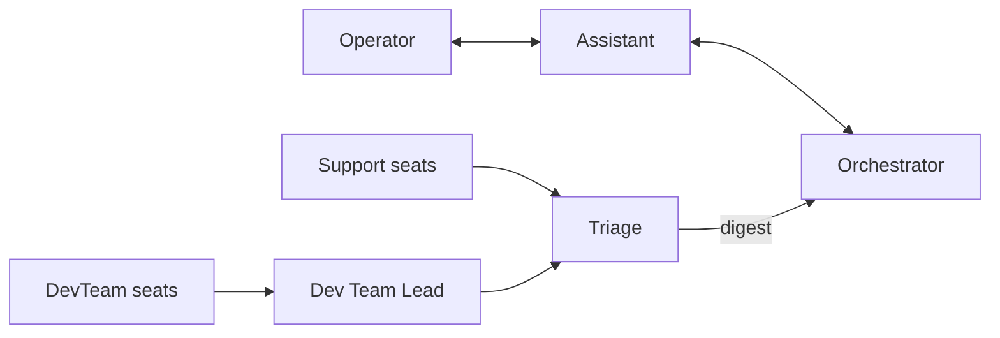

# Runbooks

The fleet runs in three parts. Admin is the operator's Orchestrator and
Assistant panes. Support is one tab of standing seats that carry releases,
triage, the operational digest, stalled-session recovery and task
consolidation. Each code task gets its own DevTeam, which ends when the task
closes. This guide covers how each part starts and where its seats report.
[Pipelines](pipelines.md#runbooks) owns the runbook mechanics: the seat guard,
restart adoption, failed runs and stopping a seat.

## Start Admin

Admin is not a runbook. Type the cold start in any workspace pane:

```text
/gobby admin        Claude, Grok, Droid and AGY
$gobby admin        Codex
```

The typing pane becomes the Orchestrator. A split beside it in the same tab
opens the Assistant with the same CLI, which runs `/gobby assistant`. To start
from the Assistant's side, type `/gobby assistant` (`$gobby assistant` in
Codex): the typing pane becomes the Assistant and the Orchestrator opens beside
it.

Both commands are re-runnable. A live counterpart session for the project on
this machine, or a counterpart pane in the same tab, is reused instead of
opened again. The router calls `gobby-agents:cold_start_admin`, which refuses
`pane_unavailable` outside a workspace pane and `unsupported_provider` for a CLI
it cannot launch. Only the space forms cold start: `/gobby:admin` and
`/gobby admin <request>` load the admin capability reference instead.

## Message routing



Only the Assistant and Triage message the Orchestrator. The daemon refuses any
other seat's direct send with `message_recipient_not_allowed`, and project or
global fanout withholds the Orchestrator. Triage sends one queued digest every
five minutes, and forwards a blocker that stops a team, or anything from the
operator, at once. DevTeam seats report to their Dev Team Lead, which reports to
Triage. See [agents](agents.md#seats) for each seat's role.

## Launch Support

The Orchestrator launches the `support` runbook into one Support tab in the
shared checkout. It holds the Release Manager, Triage, Archivist, Recovery
Steward and Consolidator. The Log Monitor and Metrics Monitor are in neither
runbook; the Orchestrator spawns them on the operator's go.

Triage goes first, because the other seats report to it:

```bash
gobby pipelines run support -i workspace=<workspace> -i project_path=<checkout> \
  -i seats=triage -i report_to=<Orchestrator ref>
gobby pipelines run support -i workspace=<workspace> -i project_path=<checkout> \
  -i report_to=<Triage ref>
```

Add the project policy's `launch_defaults.support` values as inputs. The guard
skips each seat whose agent already runs live in the project on this machine,
so the second run launches only the missing seats, and a later re-run fills
gaps without duplicating a seat. Relaunch a missing Triage first the same way.

## Launch a DevTeam

Run the single devteam pipeline for either a task or epic with task, workspace,
report_to and project_policy.launch_defaults.devteam. It launches developer,
code-reviewer and dev-team-lead in Dev Team - #N. The pair uses the registered
task tree; the lead stays in main. admit_team chooses single-task or epic mode.
The bundled file is dev-team.yaml; there is no separate epic pipeline.

claim_flow is declared in the pipeline and applied atomically by record_attestation:
implement requires test-before, implementation, test-after, self-review and
validation; review requires independent-review and validation; a rejection returns
the claim to implement; completed review moves it to the lead's validate stage.
Each stage validates against task.validation_criteria with stage and a per-criterion
[{criterion, met, how}] list. Results follow each kind's allowed_results and guidance.

The lead checks attestations and security, lands, validates the integrated SHA
after landing, records closing and closes. Developers and reviewers never land,
merge, close or delete worktrees. The lead deletes only clean merged worktrees
after associated seats end, without force. Superseded evidence remains in history.

For an epic retain the primary pair and shared tree; the lead schedules ready
leaves and parallel child teams through the same pipeline using parent_team_id.
Child leads land into epic main under clean-tree coordination. The lead's named
integration-leaf step provides a claimable task for implementation repairs and
final integration checks; the lead performs base merges. Final review is independent
of all descendant code/test authors and binds the candidate and subtree_revision.

Relaunch missing seats with seats and team_id, the original admission execution,
preserving the task, tree and provider/model/effort defaults. Never duplicate a live
team. Report through the configured report target and use durable waits.

## Launch planning

The Orchestrator launches `team-planning` with `task`, `workspace`, `project_path`,
`seats` and `report_to=<Triage ref>`. The Plan Writer opens the `Team Planning - #<task>`
tab, the Plan Adversary and Plan Enhancer split beside it, and `seat_pane` adds
seats to an existing pane.
When `task` has no open planning child, the runbook creates one under it, and the
Plan Writer claims that child before writing `.gobby/plans/task-<seq>.md`. Each seat's
prompt names the task, the plan path and its teammates' session refs. Once the seats
launch, the runbook also sends the Plan Writer the Adversary and Enhancer refs.
The Writer's enhancer edits, unresolved disagreements and stamped plan reach
the Orchestrator through Triage's digest.

The operator can launch the three-seat `team-planning` runbook directly:
`gobby pipelines run team-planning -i workspace=<name> -i task=<#N> -i project_path=<path> -i report_to=<ref> -i seats=<names>`.

_Last verified: 2026-10-23_
