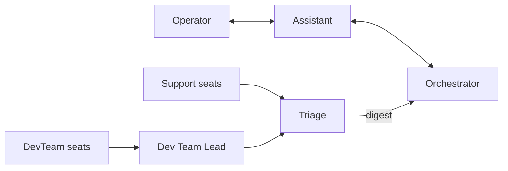

# Runbooks

The fleet runs in three parts. Admin is the operator's Orchestrator and
Assistant seats. Support is one tab of standing seats that carry releases,
triage, the operational digest, stalled-session recovery and task
consolidation. Each code task gets its own DevTeam, which ends when the task
closes. This guide covers how each part starts and where its seats report.
[Pipelines](pipelines.md#runbooks) owns the runbook mechanics: the seat guard,
restart adoption, failed runs and stopping a seat.

## Start Admin

Admin is not a runbook. Activate its definition in an operator-opened pane:

```text
/gobby agents orchestrator        Claude, Grok, Droid and AGY
$gobby agents orchestrator        Codex
```

The typing pane becomes the Orchestrator. The Orchestrator then spawns the
Assistant into its sandbox, so no Assistant pane is opened by hand and there is
no `/gobby assistant` command.

The router calls `gobby-agents:apply_agent_definition` for the current session
and opens no second pane. Eligible definitions are enabled, support the persona
surface and require no pipeline. Invalid names return eligible choices without
changing the session. `/gobby persona <name>` applies only a persona overlay.

## Message routing



Only the Assistant and Triage message the Orchestrator. The daemon refuses any
other seat's direct send with `message_recipient_not_allowed`, and project or
global fanout withholds the Orchestrator. Triage sends one queued digest every
five minutes, and forwards a blocker that stops a team, or anything from the
operator, at once. DevTeam seats report to their Dev Team Lead, which reports to
Triage. See [agents](agents.md#seats) for each seat's role.

## Launch Support

The Orchestrator launches the `support` runbook into one Support tab in the
shared checkout. It holds the Release Manager, Triage, Archivist, Security
Auditor, Recovery Steward and Consolidator.

Triage goes first, because the other seats report to it:

```bash
gobby pipelines run support -i workspace=<workspace> -i project_path=<checkout> \
  -i seats=triage -i report_to=<Orchestrator ref>
gobby pipelines run support -i workspace=<workspace> -i project_path=<checkout> \
  -i report_to=<Triage ref>
```

Pass no model inputs: each seat's model comes from the project policy's
`agent_model_defaults` entry, or from its definition when the policy names none.
The guard skips each seat whose agent already runs live in the project on this machine,
so the second run launches only the missing seats, and a later re-run fills
gaps without duplicating a seat. Relaunch a missing Triage first the same way.

## Launch a DevTeam

Run the single dev-team pipeline for either a task or epic with task, workspace
and report_to. Seat models come from the project policy's `agent_model_defaults`
map, or from each definition, unless a `<seat>_model` input overrides them. It launches developer,
code-reviewer and dev-team-lead in Dev Team - #N. The pair uses the registered
task tree; the lead stays in main. admit_team chooses single-task or epic mode.
The bundled file is dev-team.yaml; there is no separate epic pipeline.

claim_flow is declared in the pipeline and applied atomically by record_attestation:
implement requires test-before, implementation, test-after, self-review and
validation; review requires independent-review and validation; a rejection returns
the claim to implement; completed review moves it to the lead's validate stage.
Each stage validates against task.validation_criteria with stage and a per-criterion
[{criterion, met, how}] list. Results follow each kind's allowed_results and guidance.

The lead checks attestations and security, lands, validates the integrated SHA
after landing, records closing and closes. Developers and reviewers never land,
merge, close or delete worktrees. The lead deletes only clean merged worktrees
after associated seats end, without force. Superseded evidence remains in history.

For an epic retain the primary pair and shared tree; the lead schedules ready
leaves and parallel child teams through the same pipeline using parent_team_id.
An epic has one lead. A run with parent_team_id launches developer and reviewer
seats in its child tree but no lead: the guard maps its dev-team-lead seat to the
epic team's live lead, connect-epic-lead messages that lead the child's team, tree
and seats, and at validate the daemon hands the epic lead the leaf's claim. The
epic lead lands the leaf into the epic branch under clean-tree coordination,
validates, closes it and removes the clean child tree. Once every descendant is
closed, an epic team seat may claim the epic root for final validation. The lead's named
integration-leaf step provides a claimable task for implementation repairs and
final integration checks; the lead performs base merges. Final review is independent
of all descendant code/test authors and binds the candidate and subtree_revision.

Relaunch missing seats with seats and team_id, the original admission execution,
preserving the task, tree and provider/model/effort defaults. Never duplicate a live
team. Report through the configured report target and use durable waits.

## Launch planning

The Orchestrator launches `plan-team` with `task`, `workspace`, `project_path`,
`seats` and `report_to=<Triage ref>`. The Plan Writer opens the `Plan Team - #<task>`
tab, the Plan Adversary and Plan Advocate split beside it, the `plan-team-lead` splits
last, and `seat_pane` adds seats to an existing pane.
When `task` has no open planning child, the runbook creates one under it, and the
Plan Writer claims that child before writing `.gobby/plans/task-<seq>.md`. Each seat's
prompt names the task, the plan path and its teammates' session refs, and the lead's
launch prompt names every team seat, launched or already live. The runbook then sends each
team seat its lead's session ref and its teammates' refs, so the seats report to the lead;
a live lead gets the team's refs in a message. A partial rerun reconnects the whole roster.
Until that connect message, the seats report to `report_to`. The lead relays the exchange and delivers the reviewed plan,
its stamped plan and open objections to `report_to`, which Triage digests.

The operator can launch the four-seat `plan-team` runbook directly:
`gobby pipelines run plan-team -i workspace=<name> -i task=<#N> -i project_path=<path> -i report_to=<ref> -i seats=<names>`.

_Last verified: 2026-10-23_
