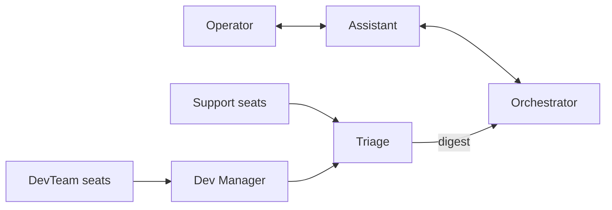
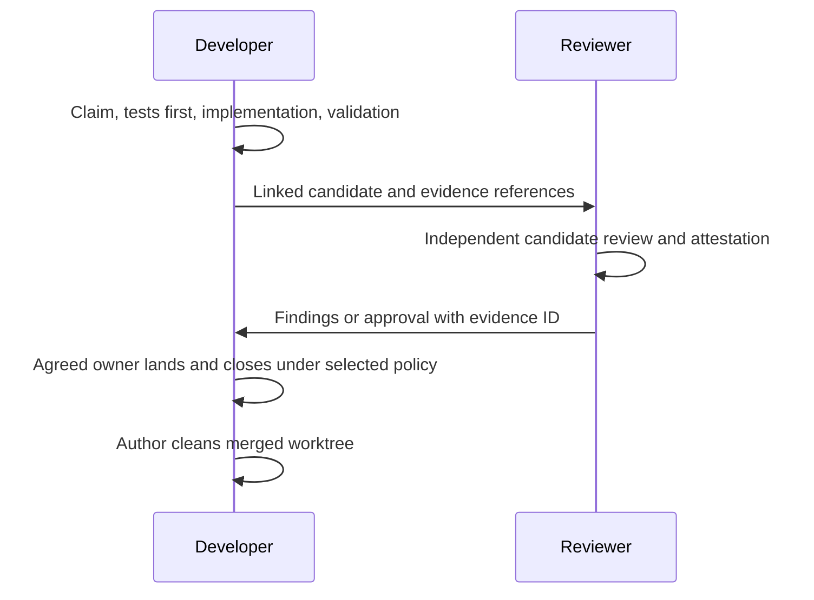

# Runbooks

The fleet runs in three parts. Admin is the operator's Orchestrator and
Assistant panes. Support is one tab of standing seats that carry releases,
triage, the operational digest, stalled-session recovery and task
consolidation. Each code task gets its own DevTeam, which ends when the task
closes. This guide covers how each part starts and where its seats report.
[Pipelines](pipelines.md#runbooks) owns the runbook mechanics: the seat guard,
restart adoption, failed runs and stopping a seat.

## Start Admin

Admin is not a runbook. Type the cold start in any workspace pane:

```text
/gobby admin        Claude, Grok, Droid and AGY
$gobby admin        Codex
```

The typing pane becomes the Orchestrator. A split beside it in the same tab
opens the Assistant with the same CLI, which runs `/gobby assistant`. To start
from the Assistant's side, type `/gobby assistant` (`$gobby assistant` in
Codex): the typing pane becomes the Assistant and the Orchestrator opens beside
it.

Both commands are re-runnable. A live counterpart session for the project on
this machine, or a counterpart pane in the same tab, is reused instead of
opened again. The router calls `gobby-agents:cold_start_admin`, which refuses
`pane_unavailable` outside a workspace pane and `unsupported_provider` for a CLI
it cannot launch. Only the space forms cold start: `/gobby:admin` and
`/gobby admin <request>` load the admin capability reference instead.

## Message routing



Only the Assistant and Triage message the Orchestrator. The daemon refuses any
other seat's direct send with `message_recipient_not_allowed`, and project or
global fanout withholds the Orchestrator. Triage sends one queued digest every
five minutes, and forwards a blocker that stops a team, or anything from the
operator, at once. DevTeam seats report to their Dev Manager, which reports to
Triage. See [agents](agents.md#seats) for each seat's role.

## Launch Support

The Orchestrator launches the `support` runbook into one Support tab in the
shared checkout. It holds the Release Manager, Triage, Archivist, Recovery
Steward and Consolidator. The Log Monitor and Metrics Monitor are in neither
runbook; the Orchestrator spawns them on the operator's go.

Triage goes first, because the other seats report to it:

```bash
gobby pipelines run support -i workspace=<workspace> -i project_path=<checkout> \
  -i seats=triage -i report_to=<Orchestrator ref>
gobby pipelines run support -i workspace=<workspace> -i project_path=<checkout> \
  -i report_to=<Triage ref>
```

Add the project policy's `launch_defaults.support` values as inputs. The guard
skips each seat whose agent already runs live in the project on this machine,
so the second run launches only the missing seats, and a later re-run fills
gaps without duplicating a seat. Relaunch a missing Triage first the same way.

## Launch a DevTeam

The bundled devteam pipeline launches two seats for one task: a developer and
an independent code reviewer in the same registered task worktree. Supply task,
workspace, report_to and the current project_policy.launch_defaults.devteam.
Its strict input schema accepts provider/model/effort settings for those two
seats. It has no manager, separate test-writer or fresh-reviewer input.

Admission creates or reserves the registered task checkout. The pipeline opens
the developer with task_id (requesting its claim), and opens the reviewer
without task_id (observing rather than claiming implementation). Both use the
admitted project_path and reserved run IDs. It connects them with an ordinary
durable message and makes a best-effort layout request. Layout refusal does
not invalidate successful seat admission.



The developer keeps the implementation claim. Messages do not automatically
bind candidates, transfer claims, count rejections, assign a fixer or escalate.
The reviewer records their own exact-reference review; a replacement candidate
requires fresh evidence. The pair agrees on one completion owner. Either
definition can land and close when its declared authority and selected policy
permit it; a manager binding is not required.

Selected coding YAML requires TDD, implementation, passing validation,
OCR self-review, closing evidence and the relevant Git facts. Pair YAML also
requires independent review, and labelled security work keeps independent
security approval. Default selects a self-delivery policy and can complete a
task without the pair. Other domains can select different evidence standards,
including work with no Git repository.

Task dependencies resolve through lifecycle closure, not approved implementation
records. Preserve explicit holds and live task/worktree ownership. Team
hierarchy and checkout safety are generic infrastructure, not a required
four-seat epic roster or synthesized review stage.

After landing and closure the author personally removes the clean, merged
registered worktree and branch, using the stored landing target and no force.
Shared worktrees remain while open work or live participants need them.

## Launch planning

The Orchestrator launches `team-planning` with `task`, `workspace`, `project_path`,
`seats` and `report_to=<Triage ref>`. The Plan Writer opens the `Team Planning - #<task>`
tab, the Plan Adversary and Plan Enhancer split beside it, and `seat_pane` adds
seats to an existing pane.
When `task` has no open planning child, the runbook creates one under it, and the
Plan Writer claims that child before writing `.gobby/plans/task-<seq>.md`. Each seat's
prompt names the task, the plan path and its teammates' session refs. Once the seats
launch, the runbook also sends the Plan Writer the Adversary and Enhancer refs.
The Writer's enhancer edits, unresolved disagreements and stamped plan reach
the Orchestrator through Triage's digest.

The operator can launch the three-seat `team-planning` runbook directly:
`gobby pipelines run team-planning -i workspace=<name> -i task=<#N> -i project_path=<path> -i report_to=<ref> -i seats=<names>`.

_Last verified: 2026-10-23_
