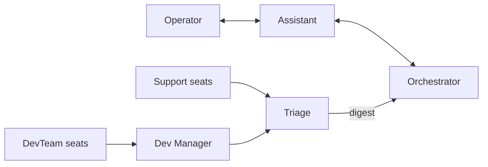
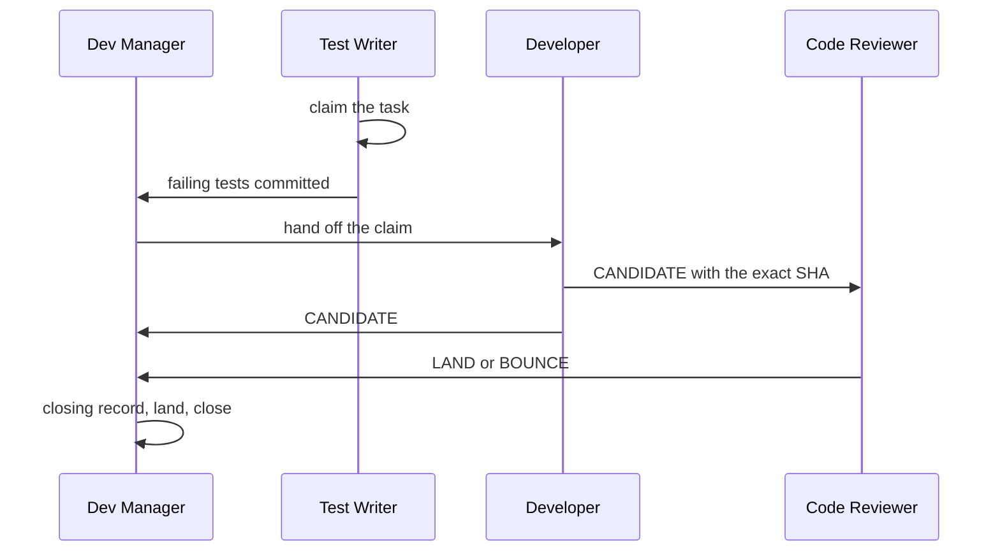

# Runbooks

The fleet runs in three parts. Admin is the operator's Orchestrator and
Assistant panes. Support is one tab of standing seats that carry releases,
triage, the operational digest, stalled-session recovery and task
consolidation. Each code task gets its own DevTeam, which ends when the task
closes. This guide covers how each part starts and where its seats report.
[Pipelines](pipelines.md#runbooks) owns the runbook mechanics: the seat guard,
restart adoption, failed runs and stopping a seat.

## Start Admin

Admin is not a runbook. Type the cold start in any workspace pane:

```text
/gobby admin        Claude, Grok, Droid and AGY
$gobby admin        Codex
```

The typing pane becomes the Orchestrator. A split beside it in the same tab
opens the Assistant with the same CLI, which runs `/gobby assistant`. To start
from the Assistant's side, type `/gobby assistant` (`$gobby assistant` in
Codex): the typing pane becomes the Assistant and the Orchestrator opens beside
it.

Both commands are re-runnable. A live counterpart session for the project on
this machine, or a counterpart pane in the same tab, is reused instead of
opened again. The router calls `gobby-agents:cold_start_admin`, which refuses
`pane_unavailable` outside a workspace pane and `unsupported_provider` for a CLI
it cannot launch. Only the space forms cold start: `/gobby:admin` and
`/gobby admin <request>` load the admin capability reference instead.

## Message routing



Only the Assistant and Triage message the Orchestrator. The daemon refuses any
other seat's direct send with `message_recipient_not_allowed`, and project or
global fanout withholds the Orchestrator. Triage sends one queued digest every
five minutes, and forwards a blocker that stops a team, or anything from the
operator, at once. DevTeam seats report to their Dev Manager, which reports to
Triage. See [agents](agents.md#seats) for each seat's role.

## Launch Support

The Orchestrator launches the `support` runbook into one Support tab in the
shared checkout. It holds the Release Manager, Triage, Archivist, Recovery
Steward and Consolidator. The Log Monitor and Metrics Monitor are in neither
runbook; the Orchestrator spawns them on the operator's go.

Triage goes first, because the other seats report to it:

```bash
gobby pipelines run support -i workspace=<workspace> -i project_path=<checkout> \
  -i seats=triage -i report_to=<Orchestrator ref>
gobby pipelines run support -i workspace=<workspace> -i project_path=<checkout> \
  -i report_to=<Triage ref>
```

Add the project policy's `launch_defaults.support` values as inputs. The guard
skips each seat whose agent already runs live in the project on this machine,
so the second run launches only the missing seats, and a later re-run fills
gaps without duplicating a seat. Relaunch a missing Triage first the same way.

## Launch a DevTeam

The Orchestrator launches `devteam` once per code task, with `task`,
`workspace`, `report_to=<Triage ref>` and the project policy's
`launch_defaults.devteam`. Teams run in parallel as load allows.

The `admit_team` step creates the task's branch and worktree from the
integration branch, both named `task-<seq>-<title-slug>`, and refuses
`team_exists` while the task already has a live team tree. The Test Writer,
Developer, Code Reviewer and Dev Manager then open in one tab titled with the
branch.



The Dev Manager moves the task claim between seats with
`gobby-tasks:hand_off_task_claim`. After an approved review record on the exact
SHA it writes the closing record, lands that SHA and closes the task. The close
ends the team: the daemon stops its seats and removes its worktree.

A replacement execution for a running team passes `team_id`, the admitting
execution id, with the same task.

### Fresh reviewer

After the second rejection the Dev Manager reports
`EVENT=REJECTION_2 TASK=#<seq> TEAM=<team id> COMMIT=<sha> REVIEWERS=<refs>`,
and Triage carries the line in its next digest. The Orchestrator relaunches
`devteam` for that team with `team_id=<TEAM>`, `fresh_reviewer=true`,
`exclude_reviewers=<REVIEWERS>`, the team's workspace and
`report_to=<Dev Manager ref>`. Only a fresh Code Reviewer launches, under the
`fresh_reviewer_*` identity. `admit_team` requires exactly two rejected review
rounds and the claim already handed to one of the excluded reviewers. When the
launch fails, the Orchestrator escalates the task rather than substituting
another reviewer.

### Epic mode

A team bound to an epic runs in epic mode. Its binding is an epic with open non-epic descendants, and each leaf is one of those descendants at any depth. The team's tree is `wt-epic-<seq>-<slug>` on branch `epic/<seq>/main`. Each sub-worktree leaf works on `epic/<seq>/<leaf-seq>` in `wt-epic-<seq>-<leaf-seq>-<slug>`, cut from epic main. The Dev Manager never claims the epic: it lands and closes the epic, and `land_commit` refuses a session that ever claimed the task. Each seat takes the claim on its leaves, and each seat's spawn is scoped by its step grant.

Launch the runbook with `task` set to the epic and `reviewer_agent` set to the precedence winner over the leaves' approvals. The Dev Manager's epic phases are in its procedure reference. In epic mode no reviewer fixes a leaf: a leaf that exhausts its review rounds escalates, and the epic escalates once.

## Launch planning

The Orchestrator launches `team-planning` with `task`, `workspace`, `project_path`,
`seats` and `report_to=<Triage ref>`. The Plan Writer opens the `Team Planning - #<task>`
tab, the Plan Adversary and Plan Enhancer split beside it, and `seat_pane` adds
seats to an existing pane.
The Writer's enhancer edits, unresolved disagreements and stamped plan reach
the Orchestrator through Triage's digest.

The operator can launch the three-seat `planning` runbook directly:
`gobby pipelines run planning -i workspace=<name> -i seats=<names>`.

_Last verified: 2026-10-23_
