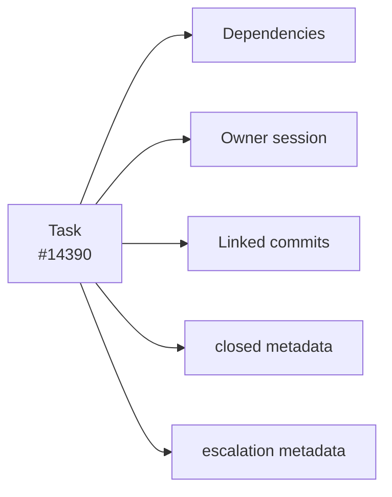

# Task Management Guide

Gobby's task system is the durable work ledger for local-first development. It
tracks task trees, dependency edges, session ownership, validation, and commit
links across restarts and agent handoffs.

Use the MCP tools for agent lifecycle work. Use the CLI for human inspection and
manual operator actions.

## Current Model



The storage row still has task metadata such as title, description, priority,
type, category, parent, labels, and validation criteria. The workflow-facing
state comes from closure, escalation, holds, dependencies, and ownership:

- `open`: unclaimed work with no hold or unresolved blocker.
- `in_progress`: claimed work with no hold or unresolved blocker.
- `blocked`: work waiting on an external dependency or merge blocker.
- `needs_human`: work explicitly held for human input.
- `escalated`: work escalated for intervention.
- `deferred`: work held with a required follow-up date.
- `closed`: work with closure metadata and a required close reason.

The precedence is closed, escalated, explicit hold, blocked, in_progress, open.
The existing `awaiting-human-review` label also projects to `needs_human`.
Reaching a deferred task's follow-up date does not itself release the hold.
Review results are independent of task state. Readiness remains a query for
eligible work, rather than a task-state value.

A claim records the owner session. The projected task state is not a free-form
`status` field. Agent code should use lifecycle tools such as `claim_task` and `close_task`
instead of trying to set `status` or `assignee` through `update_task`.

## Agent Workflow

For a known task tool without a current-context lease, agents should fetch its
schema directly before invoking it:

```python
get_tool_schema(server_name="gobby-tasks", tool_name="create_task")
call_tool(server_name="gobby-tasks", tool_name="create_task", arguments={...})
```

The task server resolves the calling session from the Gobby session context. Do
not pass `session_id` inside `gobby-tasks` tool arguments unless that tool's
schema explicitly includes it.

### Create and Claim

```python
call_tool(server_name="gobby-tasks", tool_name="create_task", arguments={
    "title": "Fix stale task guide",
    "description": "Audit docs/guides/tasks.md against current behavior.",
    "category": "docs",
    "priority": 2,
    "task_type": "task",
    "labels": ["docs", "audit"],
    "validation_criteria": "Task examples match registered schemas and all guide links resolve.",
    "claim": True,
})
```

`create_task` requires `title`, `category`, and nonempty `validation_criteria`
for every task type except `epic`, regardless of category. Valid categories are:

| Category | Use for |
| :--- | :--- |
| `code` | Implementation work. Requires `validation_criteria` and `implementation_domain` (`backend`, `frontend`, or `fullstack`). |
| `config` | Configuration changes. |
| `docs` | Documentation changes. |
| `manual` | Manual verification. |
| `planning` | Design or architecture planning. |
| `refactor` | Refactoring and test updates emitted by expansion. |
| `research` | Investigation. |
| `test` | Test-writing and test infrastructure. |

Valid task types are `task`, `bug`, `feature`, `epic`, `chore`, `refactor`,
`simple_fix`, `research_spike`, `architecture_doc`, and `prd_doc`. Use canonical values from the registered schema; do not rely on internal
normalizers to accept aliases at the public tool boundary.

To claim existing work:

```python
call_tool(server_name="gobby-tasks", tool_name="claim_task", arguments={
    "task_id": "#14390",
})
```

`claim_task` sets canonical ownership for the current session and detects claim
conflicts. `force=true` overrides another owner and should be reserved for
explicit recovery situations. A session may hold any number of active claims.
Each successful claim selects its task for new edits and validation commands;
call `claim_task` on an already-owned task to switch back. `already_claimed`
confirms that ownership and selection. Other claims retain their edit history.
When the selected claim ends, remaining claims stay inactive until you select
one with `claim_task` before editing or validating it.

Finish or stop native shell/agent calls before explicitly switching tasks.
Live calls retain the selection from their start, even when delivery is delayed.
Completed replay bindings retire at turn end. A refused switch names running
calls; create-and-claim rolls back without creating a task. If a native child
loses ownership during a transfer, restore ownership with `claim_task` or stop
the child before retrying its edits.

Codex file changes without a tool-start event use the matching turn's selection
only when it hasn't changed. Unbound or unclaimed edits still enter the session
dirty ledger, without task attribution.

An edit cannot overlap paths still live-attributed to another active claim.
Select their owning task or finish it, and split commits by task. A later task
may edit a committed path; those later edits do not block linking or closing the
earlier commit when their live attribution began after that path's commit.
Git records whole seconds, so same-second ordering is treated as unproven.
Close checks the task's attributed paths in every recorded checkout. Run
validation again after changes and provide the results for independent review.

### Recover a handed-off task after a developer relaunch

A DevTeam task needs no recovery: its Dev Manager lands and closes it. Outside a
DevTeam, a fresh developer workflow may no longer have its previous handoff list.
After the Orchestrator releases landed work, reclaim that task with `claim_task`. If
`de_escalate_task` or the close preview says "Finish only a task this developer
handed off", repeat `escalate_task` on the reclaimed task with the original
`Handed off: reviewer LAND ...` reason. This releases the reclaimed escalated
task and records its handoff in the current workflow. Then call
`de_escalate_task` and `close_task(preview=true)` through the ordinary developer
path. The preview checks the five close gates. Independent review remains part
of the developer workflow.
This recovery requires no workflow-variable writes.

### Close

Finish the task's validation and independent review, commit its files, and
integrate every task commit. Then preview the close:

```python
call_tool(server_name="gobby-tasks", tool_name="close_task", arguments={
    "task_id": "#14390",
    "commit_sha": "abc1234",
    "changes_summary": "Refreshed the guide; focused checks pass.",
    "preview": True,
})
```

After checking task/session/repository authorization, both leaf and epic closes
evaluate the same five gates:

| Gate | Requirement |
| :--- | :--- |
| `children_closed` | All child tasks are closed. |
| `linked_commits` | Linked or prospective commits exist, or a canonical no-work reason is supplied. |
| `uncommitted_task_edits` | Task-attributed paths are clean in every recorded checkout, with complete attribution. |
| `integration_ancestry` | Every linked or prospective commit resolves and is an ancestor of the authoritative integration branch. |
| `step_records` | Every step record the project's close policy requires is approved. Implementation, review and closing records cite the latest linked commit; a test record may cite any linked commit. With no linked commit, records carry the no-work disposition. |

The close policy is the `task_close_policy` key in the primary checkout's
`.gobby/project.json`. A candidate worktree cannot relax it.

```json
"task_close_policy": {
  "enforce_step_records": true,
  "test_categories": [],
  "review_categories": ["code", "docs"]
}
```

`enforce_step_records` defaults to false, which skips the gate. When it is true,
every non-epic task needs approved implementation and closing records. Tasks
whose category is in `test_categories` also need a test record, and tasks whose
category is in `review_categories` also need an independent review record.
Epics need no records. A malformed policy refuses the close. The final close
rechecks the records under the task lock, and `force` never bypasses them.

Preview returns `gates`, `can_close`, `closed=false`, and resolved commit
identities. It does not modify task state or commit links. Fix failed gates,
then repeat the call with `preview=false`. Close rechecks current state and
atomically links the explicit candidate with closure. A successful result has
`closed=true`. A concurrent state change can require a retry.

The close tool does not launch a reviewer or require transcript-derived test or
TDD proof. Developers and independent reviewers assess the task's acceptance
criteria and validation. Follow the task's review, landing, and activation
workflow before closing; preserve exact commands and results in completion
notes. After closing, call `gobby-memory:review_task_memories` with the task and
summary.

The close reasons are `done`, `moot`, `superseded`, and `wont_do`.
The no-work reasons `moot`, `superseded`, and `wont_do` are Orchestrator-only and allow
only a commitless close, except that the Consolidator may close `moot` or `superseded`
for an Orchestrator-directed fold or retirement; it never closes with `done` or `wont_do`.
A Dev Manager closes with `done` only, and every other seat is refused. A commitless
no-work close skips the linked-commit and ancestry gates and the
step-record gate; the child-closure and attributed-file gates still apply.
A no-work close with a linked commit fails the ancestry check, so unlink each candidate
first with a reason. A `superseded` close names its superseder in `superseded_by`.
No-work reasons do not waive child closure or attributed-file cleanliness. An epic does
not receive a separate commit exemption.

Human operators may disposition an unneeded leaf directly with
`gobby tasks close '#14390' --reason moot`. The CLI accepts only
the three canonical no-work reasons for direct leaf closure and still refuses a
task with open children. Agent lifecycle work uses MCP.

## Dependencies and Ready Work

A `blocks` dependency means the dependent task cannot become ready until the
blocker is closed. `related` and `discovered-from` are informational links.

```python
call_tool(server_name="gobby-tasks", tool_name="add_dependency", arguments={
    "task_id": "#44",
    "depends_on": "#42",
    "dep_type": "blocks",
})
```

Readiness is hierarchical. A task appears in ready work when:

1. The task is open or in progress, without an explicit hold.
2. It has no unresolved external `blocks` dependency.
3. Its parent chain is also ready.

```python
call_tool(server_name="gobby-tasks", tool_name="list_ready_tasks", arguments={
    "limit": 10,
})

call_tool(server_name="gobby-tasks", tool_name="list_blocked_tasks", arguments={
    "limit": 10,
})
```

CLI equivalents:

```bash
gobby tasks ready --limit 10
gobby tasks blocked --limit 20
gobby tasks dep add '#44' '#42'
gobby tasks dep tree '#44'
gobby tasks dep cycles
```

## Search and Listing

Use `list_tasks` for metadata filters:

```python
call_tool(server_name="gobby-tasks", tool_name="list_tasks", arguments={
    "priority": 2,
    "label": "docs",
    "limit": 20,
})
```

Use `search_tasks` for full-text search across task content:

```python
call_tool(server_name="gobby-tasks", tool_name="search_tasks", arguments={
    "query": "close validation",
    "limit": 10,
})
```

Useful CLI views:

```bash
gobby tasks list --active
gobby tasks list --claimed
gobby tasks list --ready
gobby tasks search "close validation" --limit 5
gobby tasks show '#14390'
gobby tasks stats
```

## Task Expansion

Expansion is run-based. The old saved-spec tools are retired. Use
`gobby-tasks-ops` expansion run tools or the CLI `expand` subcommands.

```python
call_tool(server_name="gobby-tasks-ops", tool_name="start_expansion_run", arguments={
    "task_id": "#42",
})

call_tool(server_name="gobby-tasks-ops", tool_name="get_expansion_run", arguments={
    "run_id": "<run_id>",
})

call_tool(server_name="gobby-tasks-ops", tool_name="validate_expansion_run", arguments={
    "run_id": "<run_id>",
})
```

CLI equivalents:

```bash
gobby tasks expand validate-plan .gobby/plans/feature.md
gobby tasks expand compile '#42' --plan-file .gobby/plans/feature.md
gobby tasks expand apply <run_id>
gobby tasks expand status <run_id>
gobby tasks expand resume <run_id>
gobby tasks expand reset '#42'
```

See [Task Expansion](./task-expansion.md) for the full run model.

## Git and Validation

Task commits are first-class metadata. Use task-linked commit messages and
close with the commit SHA:

```bash
git commit --only -m "[gobby-#14390] docs: refresh task guide" -- docs/guides/tasks.md
```

```python
call_tool(server_name="gobby-tasks", tool_name="close_task", arguments={
    "task_id": "#14390",
    "commit_sha": "abc1234",
    "changes_summary": "Refreshed the task guide for the MCP-first task flow.",
    "preview": True,
})
# Repair deterministic blockers, then repeat with preview=False.
```

Related MCP tools:

| Tool | Purpose |
| :--- | :--- |
| `link_commit` | Link a commit while keeping the task open. |
| `unlink_commit` | Remove a linked commit. Requires `reason`, refuses landed commits, and records the removal on the task's lifecycle. |
| `auto_link_commits` | Detect commits that mention task refs. |
| `get_task_diff` | Read a byte page of the linked diff plus independently paginated commit and file manifests. |
| `update_observed_files` | Annotate affected files from linked commits. |

Related CLI commands:

```bash
gobby tasks commit link '#14390' abc1234
gobby tasks commit unlink '#14390' abc1234
gobby tasks commit auto
gobby tasks diff '#14390'
gobby tasks validation-history '#14390'
```

Run focused checks appropriate to the change and retain their commands and
results for independent review. Acceptance criteria are authored task data;
the close tool enforces the five gates described above. Historical
validation records remain readable through `validation-history`.

Closing the last child may auto-close eligible organizational ancestors.
An explicit close on a claimed parent or epic uses the same gates as a leaf.

A closed task takes no new children. `create_task` and
`update_task(parent_task_id=...)` refuse a closed parent, naming it and
returning `PARENT_TASK_CLOSED` on the MCP surface; reopen that parent or pick an
open one. Reopening runs the mirror of the auto-close: `reopen_task` on a leaf
also reopens its closed ancestors, so nothing is left open underneath a closed
parent. Creation holds the parent row and closing holds its own, so a child
created while its parent is closing resolves one way or the other rather than
landing under a task that has already closed.

For `get_task_diff`, follow `byte_end` and both metadata `cursor_end` values.
Carry `snapshot_hash` and `view_hash` on every subsequent page and restart on a
stale snapshot/view error. Do not treat a complete diff-text page as a complete
commit list or file manifest.

Independent reviewers use the linked diff and complete commit/file manifests.
Follow every `get_task_diff` page, inspect all changed paths, and run relevant
checks. Review step records and landing receipts record those workflow
decisions; they are separate from the close tool's gate evaluator.

## CLI Reference

The CLI is optimized for humans and operators. Agents use MCP for mutating
lifecycle actions. Quote shell task references such as `'#14390'` so the shell
does not interpret them as comments.

```bash
# Listing and inspection
gobby tasks list [--state STATE] [--active] [--ready] [--blocked] [--closed] [--escalated]
gobby tasks list [--claimed] [--unclaimed]
gobby tasks ready [--limit N] [--priority N] [--type TYPE] [--json]
gobby tasks blocked [--limit N] [--json]
gobby tasks show TASK
gobby tasks stats

# CRUD
gobby tasks create "Title" --validation-criteria CRITERIA [-d DESCRIPTION] [-p PRIORITY] [-t TYPE] [-D BLOCKER]
gobby tasks update TASK [--title TITLE] [--validation-criteria CRITERIA] [--priority N] [--parent TASK] [--task-type TYPE]
gobby tasks close TASK [--reason REASON]
gobby tasks reopen TASK [--reason REASON]
gobby tasks delete TASK [--cascade | --unlink] [--yes]

# Dependencies and labels
gobby tasks dep add TASK BLOCKER [--type blocks]
gobby tasks dep remove TASK BLOCKER
gobby tasks dep tree TASK
gobby tasks dep cycles
gobby tasks label add TASK LABEL
gobby tasks label remove TASK LABEL

# Expansion, validation, search, backup, and maintenance
gobby tasks expand validate-plan PLAN_FILE
gobby tasks expand compile TASK [--plan-file PLAN_FILE]
gobby tasks expand apply RUN_ID
gobby tasks expand status RUN_ID
gobby tasks expand resume RUN_ID
gobby tasks expand reset TASK
gobby tasks validation-history TASK
gobby tasks search QUERY [--limit N] [--json]
gobby tasks reindex
gobby tasks backup [--output PATH] [--quiet]
gobby tasks restore [--input PATH] [--quiet]
gobby tasks doctor
```

## Storage and Backups

The canonical task data lives in Gobby's PostgreSQL hub. Gobby writes a
deterministic JSONL backup for recovery and migration:

- Default project task backup: `~/.gobby/backups/<project-uuid>/tasks.jsonl`
- Manual backup: `gobby tasks backup`, or the `gobby-tasks:backup_tasks` MCP tool,
  which writes only the default path
- Explicit non-destructive restore: `gobby tasks restore`, operator-only
- Pre-push backup: installed by `gobby install`

Backups contain only current live database rows, so deleting a task shrinks the
next backup. Restore upserts by stable ID and updated timestamp; it preserves
database-only rows and database versions newer than the backup. Restores are
never run automatically during daemon or session startup.

Restore has no MCP tool, and agent shells are refused `gobby tasks restore`. A
backup line can carry closed state, claims and review history, so only the
operator restores, from their own shell. Restore still validates every step
record before it writes anything.

The human-friendly task reference is `#N` within a project. Hierarchical task
paths are dotted `seq_num` chains such as `14370.14390`. MCP tools accept `#N`,
plain sequence numbers where the project is known, path refs, and UUIDs. The
CLI additionally accepts unambiguous UUID prefixes.

## Automation Notes

Lifecycle automation and workflow rules operate on semantic events such as `turn_start` and `turn_end`. Raw provider/runtime hooks such as
`before_agent`, `after_agent`, and `stop` are adapter details below the authoring
API. See [Workflows Overview](./workflows-overview.md) for the event model.

Agent termination is a separate runtime step. A spawned agent that finishes task
work should still call `gobby-agents:end_agent_run` so the run is released.

Docs leaf tasks may run inside the parent epic's isolation context. Do not infer
that shared isolation removes task ownership, commit, review, or validation
requirements.

## Live Interactive Work

The `live-session` label identifies an interactive umbrella task; it does not
disable task-close or epic-tree turn-end gates. Current rules require work to
finish or a genuine durable wait (such as registered background review or
dependent work). A label, arbitrary message, or stale human-wait marker does
not create that wait.

Only root interactive terminal sessions with the required live-work guidance
loaded may change the label. Spawned, automated, and web-chat sessions cannot.
Use one umbrella task for the requested scope, inspect claim ownership before
resuming, and retain normal commit, validation, review, and close obligations.
Expired-session recovery releases clean abandoned live claims and escalates
dirty or indeterminate ones for recovery.

## Related Guides

- [MCP Tools](./mcp-tools.md) for the full task tool inventory.
- [Task Expansion](./task-expansion.md) for expansion runs and validation.
- [Workflows Overview](./workflows-overview.md) for lifecycle events.
- [Worktrees](./worktrees.md) for isolation behavior.

_Last verified: 2026-09-12_
